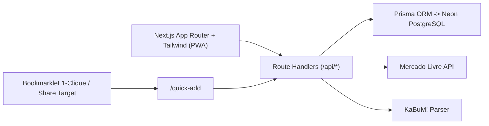

<p align="center">
  
</p>

<h1 align="center">PrecoCraft</h1>

<p align="center">
  <strong>Comparador pessoal de preços reais entre Mercado Livre, Amazon, AliExpress, KaBuM! e TikTok Shop — limpo como uma planilha, sem poluição.</strong>
</p>

<p align="center">
  
  
  
  
  
</p>

<p align="center">
  <a href="https://precocraft.netlify.app">🌐 App Online (Netlify)</a> ·
  <a href="./docs/PRD.md">📋 PRD</a> ·
  <a href="./CHANGELOG.md">📦 Changelog</a>
</p>

---

## 🎯 Problema & Proposta de Valor

Comparar manualmente produtos específicos entre **Mercado Livre, Amazon, AliExpress, KaBuM! e TikTok Shop** no Excel exige abrir várias abas e recalcular frete, cupom e cashback na mão. O **PrecoCraft** substitui a planilha por um Web App pessoal e instalável (PWA):

- **Tabela estilo Excel limpa:** menor preço final real (`base + frete - cupom - cashback`) destacado em **verde**.
- **Listas por categoria:** *Setup PC*, *Casa*, *Compras do Mês*, com filtro de *Falta comprar* / *Comprados* e busca/ordenação instantânea.
- **Pix vs. Cartão & Simulador:** alterna entre preço à vista/Pix e parcelado, além de simular quanto custaria concentrar os itens pendentes em 1 única loja.
- **Preço Alvo & Histórico leve:** badge **Na meta!** quando atinge seu valor alvo, seta de variação (`↓`/`↑`) e **Mínimo já visto**.
- **Coleta Híbrida Realista:**
  - **Mercado Livre:** busca por nome e atualização automática via API oficial.
  - **KaBuM!:** extração leve server-side (JSON-LD / `__NEXT_DATA__`).
  - **TikTok Shop, Amazon & AliExpress:** **Bookmarklet de 1 clique** na barra de favoritos + **PWA Web Share Target** no celular + múltiplos vendedores por loja.
- **Importar / Exportar CSV:** migre sua planilha do Excel e faça backups em 1 clique.

---

## ⚙️ Variáveis de Ambiente

Veja [`.env.example`](./.env.example):

| Variável | Obrigatória | Descrição |
| :--- | :---: | :--- |
| `DATABASE_URL` | Sim | Connection string PostgreSQL (Neon / Supabase). |
| `APP_PASSWORD` | Não | Senha única pessoal para proteger acesso via cookie HTTP-only. |
| `CRON_SECRET` | Não | Segredo para autenticar `GET /api/cron/refresh`. |
| `TELEGRAM_BOT_TOKEN` | Não | Token do bot para alertas de meta atingida no cron. |
| `TELEGRAM_CHAT_ID` | Não | ID do chat/grupo para receber os alertas no Telegram. |

---

## 🚀 Rodando Localmente

```bash
npm install
cp .env.example .env
# Preencha DATABASE_URL no .env
npx prisma db push
npm run dev
```

### Testes & Build

```bash
npm test
npm run lint
npm run build
```

---

## 🏛️ Arquitetura



---

## 📄 Licença

Distribuído sob a licença MIT. Veja [`LICENSE`](./LICENSE).
