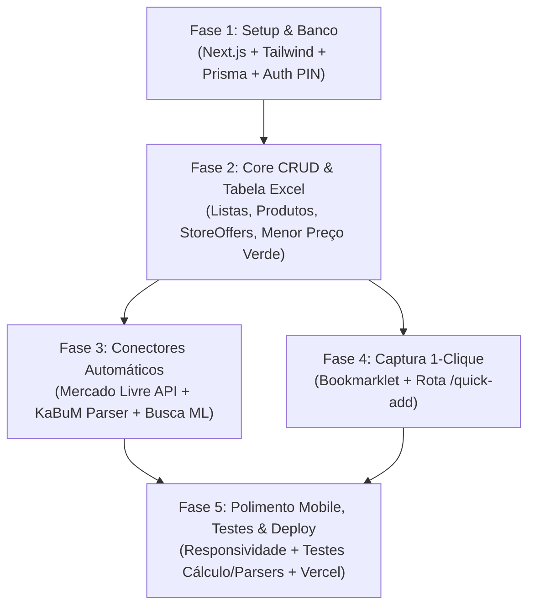

# PRD — PrecoCraft (MVP)

> **Princípio Guia (Anti-Overengineering):** Construir o mínimo necessário para substituir a planilha do Excel com zero poluição visual, alta confiabilidade na coleta de preços e custo de infraestrutura **R$ 0/mês** (Free Tier). Sem filas distribuídas, sem clusters de proxy, sem multi-tenancy complexo.

---

## 1. Problema & Proposta de Valor

### Problema
Comparar preços de produtos específicos entre múltiplos marketplaces brasileiros e internacionais (**Mercado Livre, Amazon, AliExpress, KaBuM! e TikTok Shop**) em uma planilha do Excel exige:
- Abrir 5+ abas manualmente toda vez que se quer checar se o preço mudou.
- Calcular na mão o **preço final real** (preço base + frete − cupom − cashback).
- Lidar com links quebrados, variações de anúncio e falta de praticidade no celular.

### Proposta de Valor
O **PrecoCraft** é um **Web App pessoal, limpo e responsivo** (PC e celular) com estética direta de tabela comparativa estilo Excel, focado em:
1. **Visão imediata do menor preço real** (destacado em verde) considerando frete, cupom e cashback.
2. **Organização por listas/categorias** (ex.: *Setup PC*, *Casa*, *Compras do Mês*).
3. **Coleta híbrida realista**: atualização automática onde a loja permite acesso simples (API/JSON público) e **captura em 1 clique via Bookmarklet** (e edição rápida) onde as lojas bloqueiam robôs (Amazon, AliExpress, TikTok Shop).

### Público-Alvo
Uso pessoal (single-user / proprietário único), acessado via navegador no desktop e no smartphone.

---

## 2. Escopo do MVP vs. V2 (Non-Goals)

### ✅ O que ENTRA no MVP (V1)
- **Gestão de Listas/Categorias:** Criar, renomear e filtrar listas (ex.: *Setup PC*, *Casa*, *Compras do Mês*).
- **Gestão de Produtos:** Adicionar produto manualmente, via **busca rápida por nome** (lojas com API aberta, ex.: Mercado Livre) ou **colando a URL** da oferta.
- **Tabela Comparativa Estilo Excel:**
  - Linhas = Produtos da lista selecionada.
  - Colunas = Lojas (`Mercado Livre`, `Amazon`, `AliExpress`, `KaBuM!`, `TikTok Shop`) + coluna de **Melhor Preço Real**.
  - Destaque visual **em verde** na célula com o menor preço final real daquele produto.
  - Ordenação simples e visualização responsiva (tabela no PC, cards compactos/scroll horizontal limpo no celular).
- **Calculadora de Preço Final Real:** Por oferta (`StoreOffer`), campos editáveis para:
  - `Preço Base` (`basePrice`)
  - `Frete` (`shippingCost`)
  - `Cupom / Desconto` (`discountAmount`)
  - `Cashback` (`cashbackAmount`)
  - Fórmula automática: `finalPrice = max(0, basePrice + shippingCost - discountAmount - cashbackAmount)`
- **Atualização Híbrida:**
  - Botão **"Atualizar Preços"** (por item ou por lista) que consulta automaticamente as lojas suportadas (ML e KaBuM!).
  - **Bookmarklet de 1 clique** ("+ PrecoCraft") na barra de favoritos do navegador: extrai título, preço (via JSON-LD / OpenGraph / seletores básicos) e URL da aba atual e envia direto para o app.
  - Edição inline rápida (estilo célula de Excel) para ajustar preço, frete ou cupom manualmente em segundos.
- **Proteção Simples de Acesso:** Senha única/PIN pessoal via variável de ambiente (`APP_PASSWORD` + cookie HTTP-only) para permitir deploy público na nuvem sem expor edição para terceiros.

### ❌ O que NÃO entra no MVP (Fica para V2+)
- Histórico de preços com gráficos temporais (`PriceHistory`).
- Alertas automáticos via WhatsApp/Telegram/E-mail ou Cron Jobs em background.
- Scraping pesado com Playwright/Puppeteer, proxies residenciais ou bypass de CAPTCHA para Amazon/AliExpress/TikTok Shop.
- Extensão completa publicada na Chrome Web Store (no MVP, o **Bookmarklet** entrega o mesmo fluxo de 1 clique sem burocracia).
- Multi-usuário, login social OAuth complexo, compartilhamento público ou monetização.

---

## 3. Stack Tecnológica Enxuta (Custo Zero)

| Camada | Escolha | Justificativa |
| :--- | :--- | :--- |
| **Framework** | **Next.js (App Router + TypeScript)** | Full-stack em um único repositório (UI + Route Handlers/Server Actions). |
| **Estilização** | **Tailwind CSS** | Tabela densa e limpa estilo planilha, responsiva sem peso extra. |
| **Banco de Dados** | **PostgreSQL Serverless (Neon ou Supabase Free Tier)** | Confiável, gratuito na nuvem, sem manutenção. |
| **ORM** | **Prisma ORM** | Schema tipado, migrations simples e queries diretas. |
| **Hospedagem** | **Vercel (Hobby Free Tier)** | Deploy contínuo via Git, HTTPS nativo para rodar o Bookmarklet. |

---

## 4. Modelo de Dados Enxuto

Apenas **1 enum** e **3 tabelas** no Prisma:

```prisma
enum StoreType {
  MERCADO_LIVRE
  AMAZON
  ALIEXPRESS
  KABUM
  TIKTOK_SHOP
}

model List {
  id        String    @id @default(cuid())
  name      String
  createdAt DateTime  @default(now())
  updatedAt DateTime  @updatedAt
  products  Product[]
}

model Product {
  id        String       @id @default(cuid())
  listId    String
  list      List         @relation(fields: [listId], references: [id], onDelete: Cascade)
  name      String
  notes     String?
  createdAt DateTime     @default(now())
  updatedAt DateTime     @updatedAt
  offers    StoreOffer[]

  @@index([listId])
}

model StoreOffer {
  id             String    @id @default(cuid())
  productId      String
  product        Product   @relation(fields: [productId], references: [id], onDelete: Cascade)
  store          StoreType
  url            String
  titleSnapshot  String?
  basePrice      Decimal   @db.Decimal(10, 2)
  shippingCost   Decimal   @default(0) @db.Decimal(10, 2)
  discountAmount Decimal   @default(0) @db.Decimal(10, 2)
  cashbackAmount Decimal   @default(0) @db.Decimal(10, 2)
  inStock        Boolean   @default(true)
  sourceMode     String    @default("MANUAL") // "AUTO" | "BOOKMARKLET" | "MANUAL"
  lastCheckedAt  DateTime  @default(now())
  createdAt      DateTime  @default(now())
  updatedAt      DateTime  @updatedAt

  @@unique([productId, store])
  @@index([productId])
}
```

> **Decisão de Design:** `finalPrice` não precisa ser persistido (ou pode ser calculado na camada de domínio/UI), evitando dessincronização quando `shippingCost`, `discountAmount` ou `cashbackAmount` são editados inline. A restrição `@@unique([productId, store])` garante uma célula limpa por loja na tabela comparativa; caso o usuário queira comparar dois anúncios da mesma loja no futuro, basta remover essa constraint na V2.

---

## 5. Matriz de Integração por Loja (Estratégia Realista)

| Loja | Dificuldade de Coleta | Estratégia no MVP | Busca por Nome no App? | Fluxo de Atualização |
| :--- | :---: | :--- | :---: | :--- |
| **Mercado Livre** | Baixa | **API Pública Oficial** (`api.mercadolibre.com/items/{id}` e `/sites/MLB/search?q=...`) + fallback de metadados da URL. | **Sim** (nativa via API MLB) | **Automática** (1 clique no app) + Bookmarklet |
| **KaBuM!** | Baixa / Média | **Fetch Server-Side** leve lendo JSON estruturado embutido (`__NEXT_DATA__` / JSON-LD) da página do produto + API de busca interna se estável. | **Opcional** (melhor esforço) | **Automática** (1 clique no app) + Bookmarklet |
| **Amazon** | Alta (anti-bot/CAPTCHA) | **Bookmarklet de 1 clique** (extrai preço/título direto da aba aberta pelo usuário) + edição manual inline. | **Não** | **Semi-automática** (Bookmarklet na aba aberta / Manual) |
| **AliExpress** | Alta (JS pesado/login/moeda) | **Bookmarklet de 1 clique** (lê DOM da aba autenticada em BRL) + edição manual inline. | **Não** | **Semi-automática** (Bookmarklet na aba aberta / Manual) |
| **TikTok Shop** | Muito Alta (app/mobile-first/fechado) | **Bookmarklet de 1 clique** (quando aberto no navegador) + **Entrada/Edição Manual rápida** no celular/PC. | **Não** | **Manual / Bookmarklet** |

### Como funciona o Bookmarklet de 1 clique (Sem Extensão Pesada)
1. O app fornece um botão **"Arraste para os Favoritos"** na tela de configurações/ajuda.
2. Quando o usuário está vendo um produto na Amazon, AliExpress, TikTok Shop, ML ou KaBuM!, clica no favorito **"+ PrecoCraft"**.
3. O script roda no navegador do usuário (já logado e sem bloqueio de bot), lê:
   - `window.location.href`
   - `document.title`
   - Metadados `application/ld+json` (`offers.price`), tags `og:price:amount` / `product:price:amount` ou seletores conhecidos por domínio.
4. Abre uma janela compacta (popup/aba) do PrecoCraft (`/quick-add?url=...&title=...&price=...`) onde o usuário só escolhe a **Lista** e o **Produto** (ou cria novo) e salva em 1 clique.

---

## 6. Plano de Execução em Fases (DAG)



### Detalhamento das Fases

- **Fase 1 — Fundação (Bloqueante):**
  - Inicializar projeto Next.js (App Router, TypeScript, Tailwind CSS).
  - Configurar Prisma + PostgreSQL (Neon/Supabase) com o schema (`List`, `Product`, `StoreOffer`, `StoreType`).
  - Implementar proteção simples por senha única (`APP_PASSWORD`) via cookie HTTP-only.
  - **Critério de Aceite:** App sobe localmente, conecta no Postgres, migra tabelas e protege rotas de escrita.

- **Fase 2 — Core da Planilha (Bloqueante para Fases 3 e 4):**
  - CRUD de Listas (`Setup PC`, `Casa`, etc.) com navegação por abas/sidebar limpa.
  - CRUD de Produtos e Ofertas (`StoreOffer`).
  - Função pura de cálculo de preço real (`calculateFinalPrice`) e detecção do menor preço da linha.
  - **Tabela Comparativa Estilo Excel**: colunas fixas por loja, célula vencedora destacada em verde, edição inline rápida de `basePrice`, `shippingCost`, `discountAmount` e `cashbackAmount`.
  - **Critério de Aceite:** Usuário cria lista, adiciona produtos manualmente nas 5 lojas, ajusta frete/cupom/cashback e vê o menor preço final destacado em verde em tempo real.

- **Fase 3 — Coleta Automática & Busca (Paralela à Fase 4):**
  - Adaptador **Mercado Livre**: extrair `MLB...` da URL, consultar API oficial e atualizar `basePrice` + `titleSnapshot`.
  - Endpoint de **Busca por Nome no ML**: buscar itens e fixar diretamente na lista com 1 clique.
  - Adaptador **KaBuM!**: fetch server-side com parsing de JSON-LD / `__NEXT_DATA__` e tratamento gracioso de falhas (nunca quebra a UI se a loja bloquear; mantém último valor e sinaliza).
  - Botão **"Atualizar Preços"** (item individual e lista inteira).
  - **Critério de Aceite:** Links do ML e KaBuM! atualizam preço automaticamente com feedback de status e timestamp.

- **Fase 4 — Captura em 1 Clique via Bookmarklet (Paralela à Fase 3):**
  - Gerador de Bookmarklet na UI com instruções simples (arrastar para barra de favoritos).
  - Página `/quick-add` recebendo `url`, `title`, `price`, `store` detectada automaticamente pelo domínio, permitindo vincular a um produto existente ou criar um novo na lista escolhida.
  - **Critério de Aceite:** Clicar no bookmarklet em uma página de produto preenche o formulário `/quick-add` e salva a oferta na tabela com 1 confirmação.

- **Fase 5 — Responsividade Mobile, Testes & Deploy:**
  - Ajustar experiência mobile (visualização em cards por produto ou tabela com coluna fixa de produto).
  - Testes unitários para cálculo de preço real, detecção de loja por URL e parsers (ML/KaBuM!).
  - Deploy na Vercel + variáveis de ambiente (`DATABASE_URL`, `APP_PASSWORD`).
  - **Critério de Aceite:** App acessível via URL pública no PC e no celular, testes passando e zero erros no build de produção.
